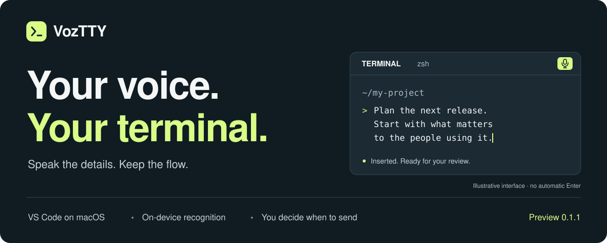

<p align="center">
  
</p>

<p align="center">
  <strong>Speak your next prompt. Stay in your terminal.</strong><br />
  Local dictation for the VS Code terminal on your Mac.
</p>

<p align="center">
  <a href="#get-started">Get started</a> ·
  <a href="#how-it-feels">How it works</a> ·
  <a href="#privacy-by-design">Privacy</a> ·
  <a href="#development">Build it</a> ·
  <a href="README.pt-BR.md">Português</a>
</p>

> **Private preview · v0.1.1**<br />
> VozTTY is being developed privately. The MIT license is ready for its future open-source release; the repository and release stay private/in draft until validation is complete and the maintainer approves publication. No public download or Marketplace listing yet.

## More room for your thoughts

Sometimes the clearest way to explain an idea is to say it out loud.

VozTTY puts a microphone in your VS Code terminal toolbar. Click, speak, stop — your words appear in the selected prompt, ready to review and edit. No separate app, no copying and pasting, and no automatic Enter.

**You speak. The text arrives. You decide when to send.**

## How it feels

| In your flow | What VozTTY does |
| :--- | :--- |
| **Choose your terminal** | Binds the recording to that session. |
| **Click the microphone** | Prepares Apple's local recognition and starts recording. |
| **Say the whole thought** | Captures your explanation without leaving VS Code. |
| **Click Stop** | Transcribes and inserts the text once, at the current cursor. |
| **Make it yours** | Review, edit, keep typing, then send when you choose. |

<kbd>Control</kbd> + <kbd>Option</kbd> + <kbd>V</kbd> starts or stops a recording while the terminal is focused. <kbd>Esc</kbd> cancels.

Text appears **after Stop**. This version does not transcribe word by word while you speak.

## Small tool. Clear boundaries.

- **Right where you work.** A microphone button in the terminal panel and terminal editor tabs.
- **Recognition on your Mac.** Apple's SpeechAnalyzer and SpeechTranscriber, through a small Swift helper.
- **Your prompt stays yours.** Existing text is not cleared. Punctuation and accents are retained; line breaks become spaces and terminal control characters are removed.
- **An explicit finish.** Stop to insert. Cancel to discard the new dictation. Switching or closing terminals cancels the recording.
- **No npm production dependencies.** A small JavaScript extension and a native macOS component.

### For your AI workflow

VozTTY is being built for prompts in **Claude Code, Codex CLI and Gemini CLI**, as well as ordinary shell input. It writes to the selected terminal rather than connecting to an assistant account.

**Compatibility checks inside those three interactive CLIs are still pending.** The microphone and insertion flow have passed tests in VS Code, including a manual dictation with the maintainer's own voice in a normal shell terminal.

## Get started

### What you need

| Requirement | Supported |
| :--- | :--- |
| Computer | Mac with Apple Silicon |
| Operating system | macOS 26 or later |
| Editor | VS Code desktop 1.93 or later |
| Languages | `pt-BR` (default), `pt-PT`, `en-US`, subject to Apple's support |
| Permission | Microphone access; Apple may download a language model on first use |

Tested on VS Code 1.142.0 and macOS 27. Browser-based VS Code, Intel Macs, Windows and Linux are not supported in this preview. Remote SSH/Container behavior remains unverified.

### Install the private preview

With a maintainer-provided VSIX or a package built from this repository:

1. Open **Extensions → … → Install from VSIX…** in VS Code.
2. Select `voztty-0.1.1-darwin-arm64.vsix`.
3. Open the integrated terminal and look for the microphone in its toolbar.
4. Authorize the microphone when macOS asks. Wait for **Voz: a gravar**, then speak.
5. Stop, review the inserted text, and send it yourself.

If the button is missing, use **Developer: Reload Window** when you can safely interrupt that window. The extension ID is `danyalgil.voz-terminal`, preserving existing installations and settings.

Set the language in **Settings → Voz: Language**. Command labels currently use Portuguese; **Voz: Começar ditado no terminal** starts dictation from the Command Palette.

## Privacy by design

**No clipboard access. No cloud transcription API. No assistant credentials. No transcript history.**

Recognition uses Apple's on-device frameworks. Audio is temporarily stored in a private local directory and deleted on normal completion or cancellation. A forced shutdown can leave temporary audio behind. Apple may download language models when needed.

VozTTY sends the final text to the terminal's input stream. It cannot identify the internal field focused inside every CLI. Use it in a text prompt: programs that react immediately to individual characters may react even without Enter.

<details>
<summary><strong>Current limits</strong></summary>

- Recognition has up to 60 seconds to return a result after Stop.
- The final transcript is limited to 64 KiB.
- Errors and cancellations discard the new dictation; existing prompt text is preserved.
- If terminal delivery throws an error, the transcript is opened in a VS Code document to avoid losing it.
- The native component is locally ad hoc signed. It has not been notarized by Apple.
- Long dictation, permissions denied on a fresh installation, remote workspaces and the three interactive assistant CLIs still need validation.

</details>

## Built, tested, still improving

| Check | Status |
| :--- | :--- |
| Text handling, targeting, cancellation and process failures | 10 automated tests passing |
| Real Apple recognition → VS Code terminal API | Passing; synthetic Portuguese recording |
| Physical microphone → transcript → terminal | Passing; acoustic test through the Mac's speakers and microphone |
| Manual dictation with the maintainer's voice | Confirmed in a normal VS Code shell terminal |
| Cancellation, restart and helper shutdown | Passing with the installed 0.1.1 package |
| Claude Code, Codex CLI and Gemini CLI input fields | Next validation step |
| Longer dictation and resource use | Pending |

Version **0.1.1** fixes a shutdown race that could generate `SIGPIPE` after a successful transcription. See the [validation notes](VALIDACAO.md) for the evidence and remaining checks. These checks are not a general accuracy benchmark.

## Development

Use Node.js 22 or later and Apple's development tools with the macOS 26 SDK or later on an Apple Silicon Mac. Access to this private repository is currently required.

```sh
git clone https://github.com/ricdanyalgil/VozTTY.git
cd VozTTY
./build-helper.sh
npm test
npx @vscode/vsce package --no-dependencies --target darwin-arm64 \
  --out voztty-0.1.1-darwin-arm64.vsix
```

Apple's frameworks and language models are provided by macOS; they are not bundled. The build script compiles and signs outside synced Documents folders before copying the helper into the extension.

<details>
<summary><strong>Integration tests</strong></summary>

Run these entrypoints through VS Code's Extension Development Host:

| Test | Configuration | Opens the microphone? |
| :--- | :--- | :--- |
| [`test/integration.js`](test/integration.js) | `VOZ_TEST_AUDIO`: synthetic speech file; optional `VOZ_TEST_RESULT`: result JSON | No |
| [`test/microphone.integration.js`](test/microphone.integration.js) | `VOZ_TEST_MICROPHONE=1` and `VOZ_TEST_RESULT`: result JSON | Yes; also plays a test phrase |

The hardware test uses the current audio devices without changing settings and records state changes and counts, not audio or transcript contents. The test host window closes when the automated test finishes; normal VS Code windows remain open.

</details>

## What's next

- [ ] Validate dictation in Claude Code, Codex CLI and Gemini CLI.
- [ ] Exercise longer speech and review resource use.
- [ ] Check fresh-install permissions and remote terminal behavior.
- [ ] Prepare the first public release after maintainer approval.
- [ ] Explore a standalone Mac terminal reusing the voice component.

The **VS Code extension comes first**. A standalone terminal is a later stage.

---

<p align="center">
  <strong>Keep the thought. Lose the typing.</strong><br />
  <a href="CONTRIBUTING.md">Contributing</a> · <a href="LICENSE">MIT license</a> · <a href="https://github.com/ricdanyalgil/VozTTY/issues">Issues</a>
</p>
