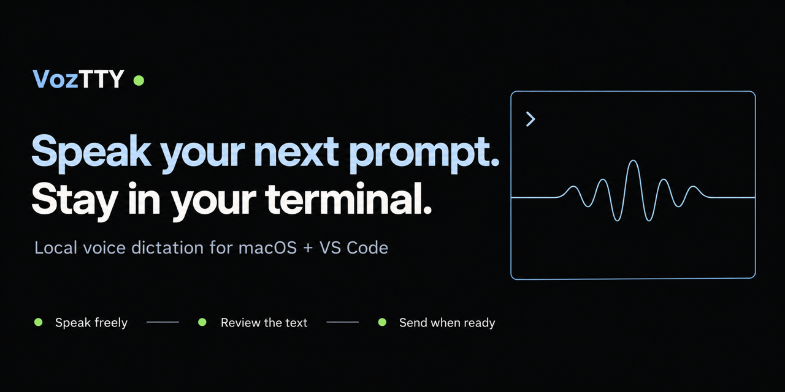
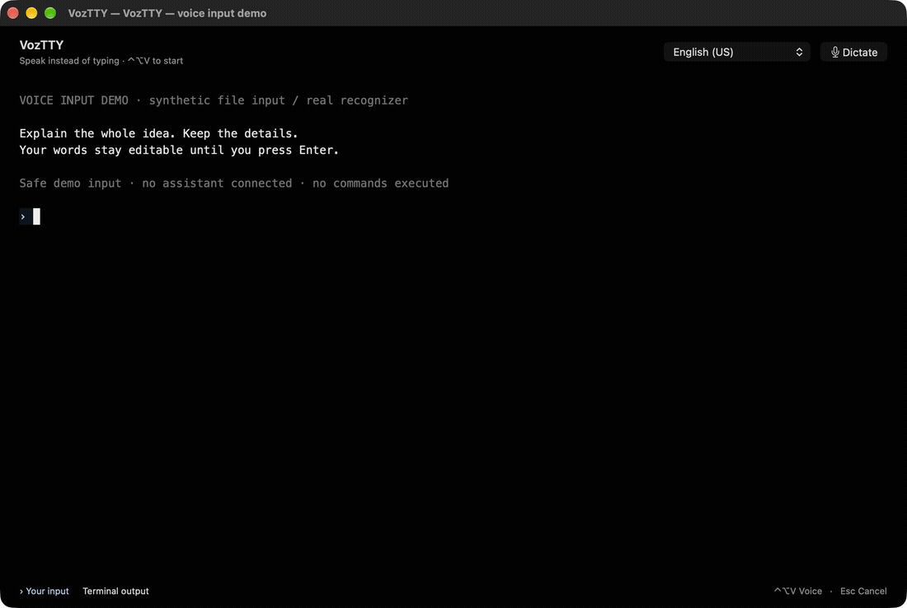
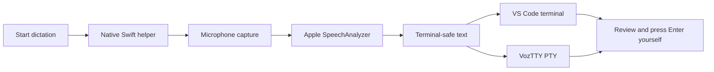

<p align="center"></p>
<h1 align="center">VozTTY</h1>
<p align="center"><strong>Speak your next prompt. Stay in your terminal.</strong><br />Local voice dictation for your Mac terminal and VS Code.<br />Speak freely. Review the text. Press Enter when you are ready.</p>

<p align="center">
  <a href="https://github.com/ricdanyalgil/VozTTY/releases/tag/v0.2.6"></a>
  <a href="LICENSE"></a>
  
  
  
  <a href="CONTRIBUTING.md"></a>
</p>

<p align="center"><a href="#download-and-install">Download</a> · <a href="#two-ways-to-work">Features</a> · <a href="#compatibility-and-validation">Compatibility</a> · <a href="#build-from-source">Build</a> · <a href="#contributions-are-welcome">Contribute</a></p>



### See the workflow


<p align="center"><sub>20-second edited walkthrough of the real app and Apple recognizer, using a synthetic audio file through a temporary demo adapter. No live microphone or assistant is connected in this clip. Frames are held for readability; this is not elapsed transcription time or an accuracy benchmark.</sub></p>

## Your voice, where you already work

**Dictating can be faster than typing long prompts—and gives you room to explain more.** Speak through your ideas, describe the context and include the details you might skip when typing. VozTTY brings a microphone directly to your terminal so you can keep your train of thought, then review and edit the transcript before sending it.

**Click the microphone → speak → stop → review → send it yourself.**

- **Local speech recognition** through Apple's SpeechAnalyzer. No VozTTY cloud account or transcription API key.
- **Direct insertion** into your prompt, preserving existing text. No clipboard round trip.
- **No automatic Enter.** Dictation stays editable until you choose to send it.
- **Three recognition languages:** Brazilian Portuguese, European Portuguese and US English, subject to Apple's model availability.
- **Keyboard control:** <kbd>Control</kbd> + <kbd>Option</kbd> + <kbd>V</kbd> starts/stops dictation; <kbd>Esc</kbd> cancels while the terminal has focus.

Text arrives **after you stop recording**. Word-by-word live transcription is not included.

**New in Terminal 0.2.6:** a transparent, borderless voice strip with a full-width, 42 px waveform showing the last 20 seconds, paused intervals, recorded duration, **Pause / Continue**, **Stop & insert**, and **Cancel**. Both downloads now include [personal vocabulary](#personal-vocabulary) for assistant and project names.

## Two ways to work

| | VozTTY Terminal | VS Code extension |
| :--- | :--- | :--- |
| Where | A standalone native Mac application | Your existing integrated terminals |
| Voice controls | **Dictate / Stop & insert** in the header | Microphone and Stop icons in the terminal toolbar |
| Display | Black background, blue prompt accents and light output | Your VS Code terminal theme |
| Window | Standard macOS title-bar controls | Standard VS Code controls |
| Engine | AppKit, WebKit, xterm.js and a real macOS PTY | VS Code terminal API and a native Swift helper |
| Current package | **0.2.6** | **0.1.3** |

The Mac terminal currently supports one window/session per instance. Tabs, split panes and session restoration are on the roadmap.

## Download and install

**Requires an Apple Silicon Mac running macOS 26 or later.** VS Code integration additionally requires VS Code desktop 1.93+. Apple's speech models may require an initial download.

| Package | Download | Install |
| :--- | :--- | :--- |
| Mac terminal | [VozTTY Terminal 0.2.6 ZIP](https://github.com/ricdanyalgil/VozTTY/releases/download/v0.2.6/voztty-terminal-0.2.6-darwin-arm64.zip) | Extract and move **VozTTY.app** to **Applications** |
| VS Code extension | [VozTTY 0.1.3 VSIX](https://github.com/ricdanyalgil/VozTTY/releases/download/v0.2.6/voztty-0.1.3-darwin-arm64.vsix) | **Extensions → … → Install from VSIX…** |
| Integrity | [SHA256SUMS.txt](https://github.com/ricdanyalgil/VozTTY/releases/download/v0.2.6/SHA256SUMS.txt) | Verify with `shasum -a 256 -c SHA256SUMS.txt` in the download folder |

These are **public preview builds**, signed ad hoc and **not notarized by Apple**. macOS may require a manual security review before opening them. Building from source is also supported. The extension is distributed through GitHub Releases; it is not listed on the VS Code Marketplace yet.

### In the Mac terminal

Open **VozTTY**, then run your installed assistant as usual:

```sh
codex
# or
claude
# or
agy
```

Click **Dictate**, wait for **Listening**, speak, then choose **Stop & insert**. Read and edit the transcript before pressing Enter. Choose your spoken language by name in the header; the interface keeps window actions in the standard macOS title bar. The CLIs must be installed and authenticated separately; VozTTY does not bundle them or manage their accounts.

### In VS Code

Install the VSIX, open an integrated terminal and click its microphone icon. You can also run **VozTTY: Start Terminal Dictation** from the Command Palette. If the icon is missing, use **Developer: Reload Window** when it is safe to interrupt your window.

The extension ID remains `danyalgil.voz-terminal`. Set **Voz: Language** (`voz.language`) to `pt-BR`, `pt-PT` or `en-US`; the default is `pt-BR`. Switching or closing the source terminal cancels an active recording.

## Personal vocabulary

VozTTY can normalize the spelling of assistant and project names after transcription, entirely on your Mac. Built-in entries include **Claude, Claude Code, Codex, OpenAI Codex, Gemini and VozTTY**; for example, “Cloud Code” becomes “Claude Code”. The word “cloud” on its own is preserved.

In the native app, choose **VozTTY → Edit Vocabulary…** (`⌘,`). In VS Code, run **VozTTY: Edit Vocabulary** from the Command Palette. Both use the same local file:

```text
~/Library/Application Support/VozTTY/vocabulary.txt
```

Save one preferred name per line. Add explicit alternatives after `=`, separated by `|`:

```text
Claude Code = Cloud Code
BlueAuth = Blue Auth
MyProject = My Project | Mai Project
```

Changes apply to the next recording, with no app restart. Matches ignore case and respect word boundaries; longer phrases win, and replacements are applied once. Use at most 100 names and alternatives, each 1–80 characters, in a UTF-8 file up to 32 KB. Blank lines and lines starting with `#` are ignored. An empty file disables all corrections; delete the file to restore the defaults. Invalid files stop dictation before microphone capture and show an error.

This is explicit text correction, **not acoustic model training or a guarantee of recognition accuracy**. Register specific alternatives to avoid changing words you intended to say. Project names stay in this local file and are not committed or uploaded by VozTTY. Transcripts remain editable and are never submitted automatically. Included in Terminal 0.2.6 and extension 0.1.3.

## Compatibility and validation

| Client / check | Verified behavior |
| :--- | :--- |
| Codex in VozTTY Terminal | Maintainer microphone test and long draft insertion |
| Claude Code in VozTTY Terminal | Maintainer microphone test and long draft/paste block insertion |
| Gemini through Antigravity (`agy`) | Maintainer microphone test and a 182-word draft retained without Enter |
| Claude Code and Codex in VS Code | Long synthetic audio recognized by the real Apple engine and inserted through the extension without Enter |
| Physical microphone, Mac terminal | Controlled 82-second recording, 182 recognized words, opening/closing and existing prefix preserved |
| Automated checks | 16 JavaScript unit tests; native PTY/input checks; window-fit regression from 620 to 1440 px |

Earlier acoustic runs lost words, and proper names can be misrecognized. The controlled long recording used speech played through speakers into the physical microphone. **It is an integration check, not a claim of perfect accuracy or a completed long test with the maintainer's natural voice.** Automated CLI tests leave prompts unsent; the maintainer separately confirmed real voice use in all three clients.

Google [moved personal-account terminal access to Antigravity CLI](https://github.com/google-gemini/gemini-cli/discussions/27274). Use `agy` for that workflow. Legacy Gemini CLI remains available with eligible enterprise or paid API access.

## How it works



The native app uses AppKit, WKWebView, xterm.js 6.0.0 and a macOS pseudo-terminal. Its renderer is bundled locally with no CDN or Node.js runtime. The extension has no npm production dependencies. Both share the same Swift speech helper. Upstream [renderer licenses](terminal/web/vendor/README.md) are included.

### Privacy and current limits

- Voice recognition runs on the Mac. VozTTY has no cloud transcription backend, assistant credentials or persistent transcript history.
- Recordings use a private temporary folder and are removed on normal completion/cancellation. A forced shutdown can leave temporary audio behind.
- Terminal control characters are removed and line breaks become spaces. A program that reacts immediately to characters can still react without Enter; dictate into the intended text input.
- Transcription has a 60-second timeout **after Stop** and a 64 KiB text limit. Recording itself is not limited to 60 seconds.
- Native prompt colors recognize `›`, `❯` and `>` markers and automatic wraps. Output using the same markers may also be highlighted; explicit multiline continuations may retain their CLI colors.
- Closing the app ends running programs and loses unsent prompts or unsaved recovery text. An active session asks for confirmation.
- Intel Macs, Windows, Linux and browser-based VS Code are unsupported. Remote terminals and fresh-install permission failures need more validation.

## Build from source

Use an Apple Silicon Mac, Apple's development tools with the macOS 26 SDK or later, and Node.js 22+ for extension packaging/tests.

```sh
git clone https://github.com/ricdanyalgil/VozTTY.git
cd VozTTY
npm test

# Native terminal
./terminal/build.sh
open terminal/VozTTY.app

# VS Code extension
./build-helper.sh
npx @vscode/vsce@4.0.0 package --no-dependencies --target darwin-arm64 \
  --out voztty-0.1.3-darwin-arm64.vsix
```

No npm install is required for production dependencies. Native checks, test-only integration hooks and icon generation are described in [`terminal/README.md`](terminal/README.md).

## Contributions are welcome

**We would love to build VozTTY with you. It would be a pleasure to welcome your contribution.**

Bug reports, documentation improvements, accessibility feedback, recognition-language testing and pull requests are all welcome. First contribution? A small documentation fix or a reproducible bug report is a great place to start.

- Read the [contribution guide](CONTRIBUTING.md).
- [Report a bug or propose an idea](https://github.com/ricdanyalgil/VozTTY/issues).
- [Open a pull request](https://github.com/ricdanyalgil/VozTTY/pulls).
- Please use synthetic examples instead of private recordings or sensitive transcripts.

### Roadmap

- Longer tests with natural speech and more microphones/languages.
- Fresh-install permissions, interruption recovery and remote-terminal validation.
- Native terminal stability, accessibility and notarized distribution.
- Tabs and split panes after the single-session experience is solid.
- VS Code Marketplace distribution.

## License

VozTTY is open source under the [MIT license](LICENSE). Copyright © 2026 Ricardo Danyalgil Junior. Bundled third-party components retain their own licenses.
