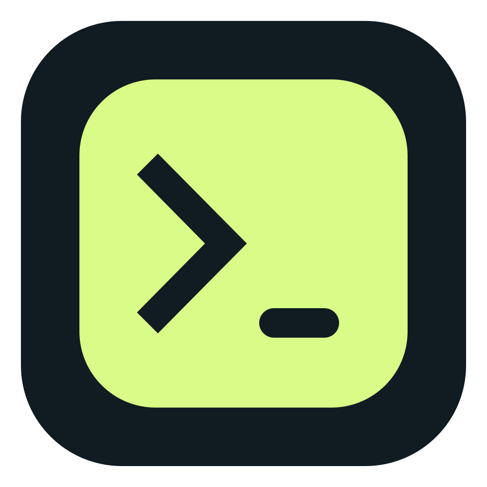
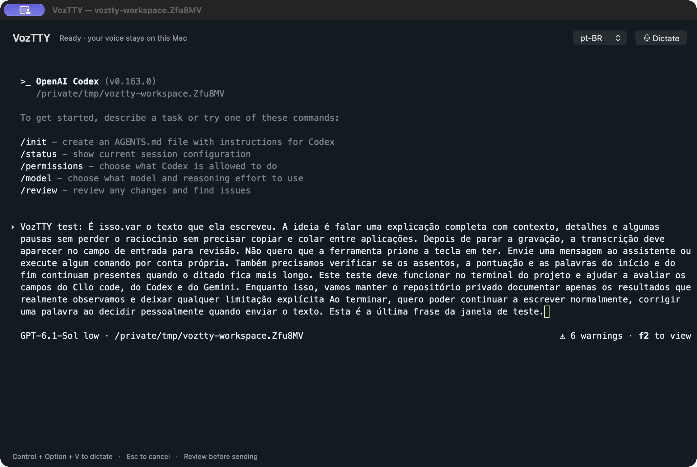
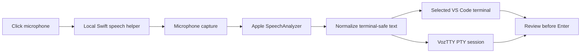

<p align="center"></p>
<h1 align="center">VozTTY</h1>
<p align="center"><strong>Your voice belongs in the terminal.</strong></p>
<p align="center">A native Mac terminal. A VS Code extension.<br />Speak the full thought, review the text, send it yourself.</p>
<p align="center"><a href="#try-it">Try it</a> · <a href="#the-experience">The experience</a> · <a href="#tested-not-assumed">Validation</a> · <a href="#under-the-hood">Architecture</a> · <a href="README.pt-BR.md">Português</a></p>

> **Private preview.** Built toward an MIT open-source release. The repository remains private and releases remain drafts until the maintainer approves publication. No Marketplace listing or public binary yet.



<p align="center"><sub>Native prototype during a real Codex CLI compatibility test. The Portuguese paragraph is synthetic test material; the draft is waiting for Enter.</sub></p>

## Keep the thought. Lose the typing.

Some ideas need more than a short command. You want to explain the context, add the details, pause and find the right words — without leaving the terminal to transcribe somewhere else.

**VozTTY brings the microphone to the prompt.** Recognition runs locally through Apple's speech frameworks. Stop recording and your text lands where you are working, with the existing prompt preserved. No clipboard. No automatic Enter.

### Two ways to work

| | **VozTTY Terminal** | **VS Code extension** |
| :--- | :--- | :--- |
| Workspace | A standalone macOS application | Your existing VS Code terminals |
| Voice control | **Dictate / Stop & insert** in the window | Microphone / Stop in the terminal toolbar |
| Terminal engine | Real PTY and login shell, rendered with xterm.js | VS Code's integrated terminal |
| Runtime | AppKit + WebKit; no Node.js runtime | JavaScript extension + native Swift helper |
| Preview | **0.2.0**, initial native terminal | **0.1.1**, installed and manually exercised |

The native app is a first working terminal, not a full terminal suite: one window and one session, with resize, terminal colors, keyboard input and voice dictation. Tabs, split panes and session restoration are not included.

## The experience

**Select your prompt → Dictate → Speak → Stop → Review.**

- Speak a whole explanation. Text is inserted **after Stop**, not word by word.
- Use <kbd>Control</kbd> + <kbd>Option</kbd> + <kbd>V</kbd> to start or stop while the terminal has focus.
- Press <kbd>Esc</kbd> to cancel while the terminal has focus.
- Keep typing after the transcript arrives. You choose when to press Enter.
- Pick `pt-BR`, `pt-PT` or `en-US`, subject to Apple's language support.

In VS Code, changing or closing the source terminal cancels the recording. In the native app, closing a running terminal asks for confirmation; unsent text and running programs are not restored afterwards.

## Try it

**Apple Silicon · macOS 26+ · microphone permission.** For the extension, use VS Code desktop 1.93+. Apple's language models may need an initial download. These previews are ad hoc signed and are not notarized by Apple.

Clone access currently requires permission to the private repository.

### Native Mac terminal

Requires Apple's development tools with the macOS 26 SDK or later. The renderer is already vendored; no npm installation is needed for the app.

```sh
git clone https://github.com/ricdanyalgil/VozTTY.git
cd VozTTY
./terminal/build.sh
open terminal/VozTTY.app
```

The build reuses the same Swift recognition helper as the extension. The shell is `/bin/zsh -l`; your normal shell configuration applies. Run your installed `claude`, `codex`, `agy` or `gemini` command as you would in another terminal. VozTTY does not bundle those CLIs or sign in for you.

For launching an executable directly from another shell:

```sh
terminal/VozTTY.app/Contents/MacOS/VozTTY -- /absolute/path/to/your/cli
```

### VS Code

With Node.js 22+ and Apple's development tools:

```sh
./build-helper.sh
npm test
npx @vscode/vsce package --no-dependencies --target darwin-arm64 \
  --out voztty-0.1.1-darwin-arm64.vsix
```

In VS Code, choose **Extensions → … → Install from VSIX…**. Open a terminal and look for the microphone. If it is missing, use **Developer: Reload Window** when you can safely interrupt the window.

The extension ID is `danyalgil.voz-terminal`. Select a language in **Settings → Voz: Language**. Extension commands currently use Portuguese: **Voz: Começar ditado no terminal** starts a recording.

## Tested, not assumed

Tests check **draft insertion**, not whether an assistant generated a response. The test prompts are deliberately left unsent.

| Check | Observed result |
| :--- | :--- |
| Core extension behavior | 10 unit tests passing: sanitization, targeting, cancellation and failures |
| Native shell / PTY | Real input, resize and a check that execution needs Enter |
| Short voice capture in VS Code | Acoustic test passed; maintainer also confirmed their own voice in a normal shell |
| Long voice capture in VozTTY Terminal | Controlled physical-microphone test: **82 seconds, 182 recognized words**, opening and closing preserved, existing prefix retained, no Enter |
| Codex CLI in VozTTY Terminal | Long draft visible in the actual composer, left unsent |
| Claude Code in VozTTY Terminal | Long draft retained as a **Pasted text** block, left unsent |
| Gemini CLI / Antigravity CLI | Personal Google accounts must use the official successor, `agy`; onboarding and input check pending |
| Claude Code + Codex CLI through the VS Code extension | 182-word drafts retained, no Enter; synthetic long audio with the real Apple recognizer |

The long acoustic test used speech played through the Mac's speakers and recorded through its physical microphone. Earlier acoustic attempts lost words; the controlled repeat preserved the opening and closing. Recognition can still substitute words and punctuation. **This is an integration check, not an accuracy benchmark or a completed long-form test with the maintainer's own voice.**

See [VALIDACAO.md](VALIDACAO.md) for test scope, versions, remaining checks and the prior `SIGPIPE` fix.

For personal Google accounts, Google [moved terminal access to Antigravity CLI](https://github.com/google-gemini/gemini-cli/discussions/27274). Install the [official client](https://antigravity.google/docs/getting-started/) and run `agy` inside VozTTY or the VS Code terminal. Gemini CLI remains supported for eligible enterprise and paid API access. VozTTY does not change authentication, accept service terms or require an API key for dictation.

## Under the hood



The native terminal uses **AppKit**, **WKWebView**, **xterm.js 6.0.0** and a real macOS pseudo-terminal. Its JavaScript and styles are bundled locally; the terminal view has no network access. Shell programs and assistant CLIs keep their own networking behavior.

The extension has **no npm production dependencies**. Both clients share the Apple recognition helper. xterm.js and the fit addon retain their [upstream MIT licenses](terminal/web/vendor/README.md).

### Privacy and limits

- Voice recognition uses Apple's local frameworks. No VozTTY cloud transcription API, assistant credentials or persistent transcript history.
- Audio is held in a private temporary directory and removed after normal completion or cancellation. A forced shutdown can leave temporary audio behind.
- Terminal controls are removed from dictated text; line breaks become spaces. Existing text is not cleared.
- Recognition has a 60-second timeout **after Stop** and a 64 KiB transcript limit. This is not a 60-second recording limit.
- A program that reacts immediately to characters can react without Enter. Dictate only into the intended text input. A CLI's own draft/history policies remain its responsibility.
- Failed delivery preserves a transcript in a recovery document/window where possible. Closing the app discards unsaved recovery text.
- Intel Macs, Windows, Linux and browser-based VS Code are unsupported. Remote terminals and fresh-install permission failures still need validation.

## Development

| Area | Source |
| :--- | :--- |
| VS Code integration | [`extension.js`](extension.js) · [`dictation.js`](dictation.js) |
| Shared speech engine | [`native/VoiceEngine.swift`](native/VoiceEngine.swift) |
| Native terminal | [`terminal/`](terminal/) |
| Unit / integration checks | [`test/`](test/) |
| Evidence and outstanding work | [`VALIDACAO.md`](VALIDACAO.md) |

Run `npm test` for the extension checks. Native tests and hardware-test setup are documented in [`terminal/README.md`](terminal/README.md). Hardware tests open the microphone only when explicitly invoked.

## Road ahead

- [ ] Complete the Gemini CLI authentication/input check.
- [ ] Confirm longer dictation with the maintainer's own voice.
- [ ] Exercise fresh permissions, interruptions and remote terminals.
- [ ] Harden the native terminal and prepare a notarized distribution.
- [ ] Open the repository and release **only after maintainer approval**.

---

<p align="center"><strong>Speak freely. Send deliberately.</strong><br /><a href="CONTRIBUTING.md">Contribute</a> · <a href="LICENSE">MIT</a> · <a href="https://github.com/ricdanyalgil/VozTTY/issues">Report an issue</a></p>
